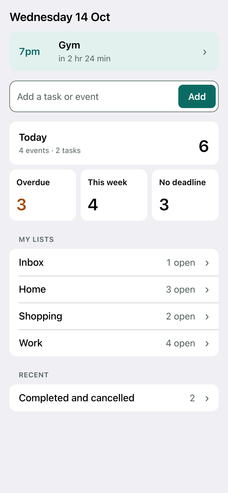
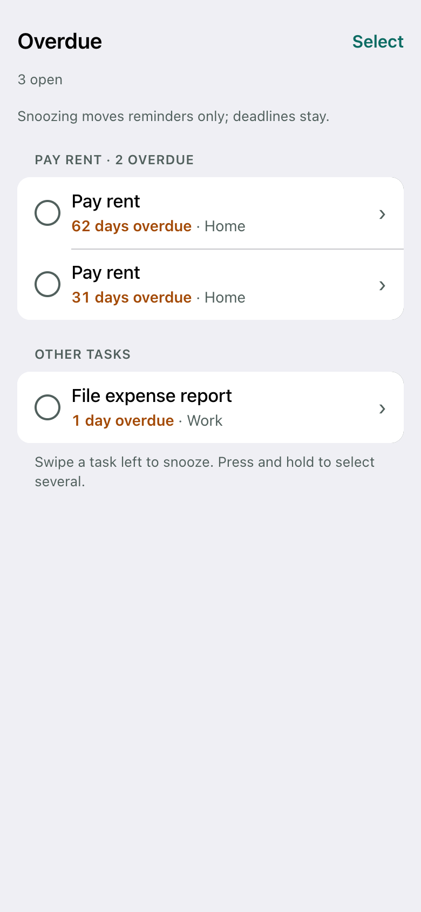
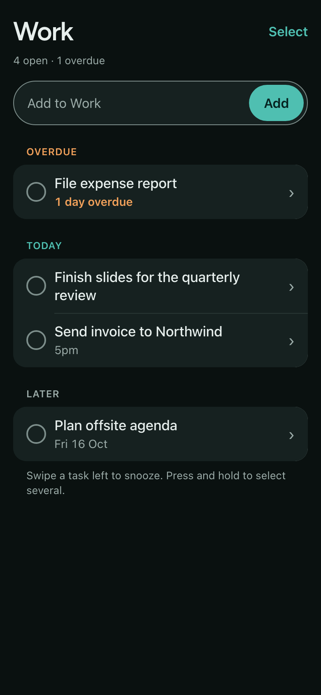
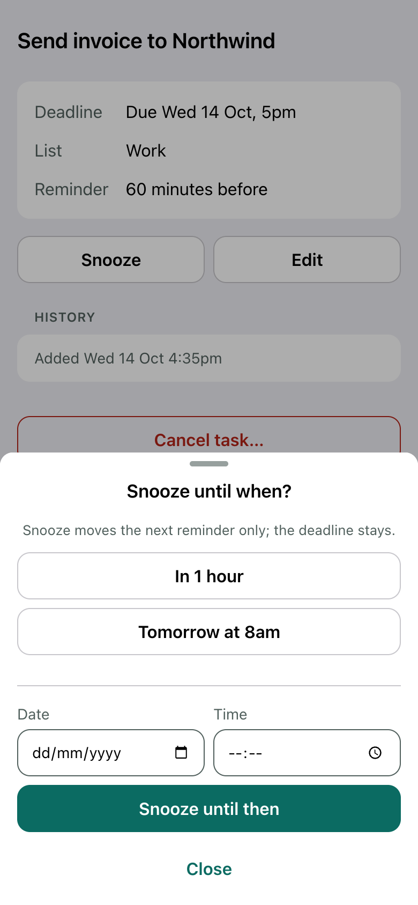

<div align="center">

<picture>
  <source media="(prefers-color-scheme: dark)" srcset="docs/identity/logo/oh-my-days-banner-dark.png">
  
</picture>

A Telegram assistant for your events and tasks, with **Google Calendar as the calendar**. Type what you need to remember, and it lands in your calendar or your task lists, then comes back as a morning agenda and reminders. It runs on free tiers only and works fully without AI.

[](CHANGELOG.md)
[](https://github.com/xinweichong/oh-my-days/actions/workflows/check.yml)
[](https://workers.cloudflare.com)
[](tsconfig.json)
[](LICENSE)

</div>

---

## Why Oh My Days?

Planning apps ask you to open another app. Oh My Days lives in a chat you already open many times a day.

**Capture in one line.** Send `Dinner Fri 7pm` and it becomes an event; send `Pay rent by 1 Nov` and it becomes a task with a deadline. If something is unclear, it asks with buttons instead of guessing.

**Google Calendar stays the calendar.** Events are real Google Calendar events. Task deadlines appear in a dedicated calendar as markers (`[Work] Send invoice`, `✓` when done), and edits you make in Google Calendar come back.

**Nothing changes without you knowing.** Every change reports exactly what happened, with Undo. Deleting, changing a whole series, or anything that emails guests asks first. A change that hasn't reached Google yet says so.

**Private and free.** It runs on your own Cloudflare account, on free tiers, for you and a few people you allow. Natural-language input through Gemini is planned but deferred; nothing is sent to an AI service today.

---

## Screenshots

The Telegram Mini App, opened from the chat (synthetic data).

<table>
  <tr>
    <td align="center"><b>Home</b></td>
    <td align="center"><b>Overdue</b></td>
    <td align="center"><b>A list, dark theme</b></td>
    <td align="center"><b>Snooze</b></td>
  </tr>
  <tr>
    <td></td>
    <td></td>
    <td></td>
    <td></td>
  </tr>
</table>

---

## Features

### Capture and change

| | |
|---|---|
| **Quick capture** | Plain messages become one event or task: weekdays, `next Fri`, `in 3 days`, `end of month`, time ranges like `7-9pm`. Ambiguity gets a question with dated buttons ("Which Friday?", "3am or 3pm?") |
| **Import** | `/import` and up to eight tasks, one per line: one preview, one confirmation, one Undo. Lines that aren't a single task are listed and skipped, and tasks you already have aren't added twice |
| **Follow-ups** | Reply to a result with `move it to 4pm`, `rename it to …`, `delete it`, or `done` |
| **Guided commands** | `/event` and `/task` walk through each step for anyone who prefers buttons; every question has Cancel |
| **Undo and confirmations** | Results carry Undo; deletions, whole-series changes and guest notifications are previewed and confirmed |
| **Invitations** | Invite by email or a saved contact; the exact recipients are shown before anything is sent |

### Tasks and lists

| | |
|---|---|
| **Lists** | Inbox plus your own lists; move tasks between them, and delete a list after confirming (its tasks move to Inbox) |
| **Deadlines in Calendar** | Date-only or exact deadlines appear as free, notification-free markers in a dedicated task calendar |
| **Recurring tasks** | Every N days, weeks, or months, weekdays, last day of the month; each occurrence is its own task. Recurring events are native Google Calendar series |
| **Snooze** | Moves the reminder only; the deadline never moves |
| **Work time** | Book time to work on a task, separate from its deadline |

### Days, reminders, and views

| | |
|---|---|
| **Morning agenda** | Today's events, due and overdue tasks at a time you choose, with a catch-up if it was missed |
| **Reminders** | Before events and exact deadlines, with location, call link, Done and Snooze; quiet hours hold them. Up to five per event or task, including date-only deadlines: presets, typed ones (`45m`, `1 day before 6pm`, `Thu 9am`), or a reply like "remind me 2h" |
| **Views** | `/daily`, `/weekly`, `/monthly`, `/overdue`, `/reminders`, `/find`, read live from Google with a labelled fallback |
| **Mini App** | Tasks and a read-only day and week overview inside Telegram: swipe to snooze, multi-select, quick add |

### Reliability

| | |
|---|---|
| **Two-way sync** | Incremental sync of selected calendars; external edits to events and task markers are imported |
| **Durable operations** | Every change is recorded before it is attempted, retried within limits, and reconciled after a lost response |
| **Health** | `/health` shows connection and sync status; `/healthz` reports scheduler liveness for monitoring |
| **Export** | `/export` sends your tasks, lists, recurring tasks, and contacts as a file |

---

## Using it

### Get started

1. Open the bot in Telegram and send `/start`. The bot only answers allowlisted Telegram accounts.
2. Connect Google Calendar from the button it sends. Authorization happens in your browser; Telegram never sees your Google password.
3. Pick the calendars to show, your default calendar for new events, and the calendar for task deadlines (Oh My Days can create one).
4. Confirm your timezone. The agenda arrives at 8am by default; change it in `/settings`.

### Type what you need

```
Dinner Fri 7pm          → an event on Friday at 7pm
Gym tomorrow 7-8am      → an event with an end time
Buy milk                → a task in Inbox
Pay rent by 1 Nov       → a task due 1 November
```

Repeating tasks and events are set up through `/task` and `/event`.

Then reply to the result: `move it to 4pm`, `rename it to Dinner with Sam`, `done`, `delete it`.

### Commands

| Command | What it does |
|---|---|
| `/event` | Add, rename, move, or delete an event |
| `/task` | Add a task, or manage lists |
| `/tasks` | Open tasks, by list, with actions |
| `/app` | Open the Mini App: tasks and your week |
| `/find` | Search tasks and events by words |
| `/daily` | Today's events, due and overdue tasks |
| `/weekly` | This week, Monday to Sunday |
| `/monthly` | This month, compactly |
| `/calendars` | One calendar's week |
| `/overdue` | Unfinished tasks past their deadline |
| `/reminders` | Upcoming and snoozed reminders |
| `/settings` | Calendars, default calendar, timezone, agenda time, quiet hours |
| `/health` | Google Calendar connection and sync status |
| `/export` | Your tasks, lists, and contacts as a file |
| `/cancel` | Stop the question the bot is waiting on |
| `/help` | Examples and commands |

The same list is in Telegram's Menu button.

### The Mini App

Open it from **Open app** under the agenda, `/daily`, `/tasks`, or `/app`, or from the bot's profile. Home shows what's next and counts for Today, Overdue, This week, and No deadline. Tap a circle to complete a task, swipe left to snooze, press and hold (or tap **Select**) to act on several at once. Telegram's main button carries the screen's main action, such as **Mark done** or **Snooze all**. The app only works opened from Telegram; it signs in with Telegram's signed launch data.

---

## Architecture

```
Telegram ──webhook──> Worker ──> durable inbox (D1) ──> router ──> application operations
                        │                                              │
Mini App ──/app/api──>  ┘                                              ├── domain rules (pure)
                                                                       ├── D1: users, tasks, lists, operations, outbox
Cron (every minute) ──> tick: sync, reminders, agenda, delivery,       └── Google Calendar adapter
                        horizon, health                                       │
                                                                              v
                                                                      Google Calendar API
```

One TypeScript Cloudflare Worker with a D1 database; the landing page at `/` is static assets on the same Worker. Telegram updates are stored before they are acknowledged, then processed one user at a time; replies go through a durable outbox. Domain logic (dates, recurrence, capture grammar, schedules) is pure and takes injected clocks and IDs; Telegram, Google, and D1 stay in adapters. Commands, typed messages, and the Mini App all call the same operations. Decisions are recorded in [`docs/adr/`](docs/adr/).

---

## Run your own

### Prerequisites

- **Node.js 24+**
- **A Telegram bot** from [@BotFather](https://t.me/botfather)
- **A Cloudflare account** (Workers Free and D1) and a domain on Cloudflare for the custom hostname
- **A Google Cloud project** with an OAuth client (Web application) and the Calendar API enabled

### Local development

No Cloudflare, Google, or Telegram account is needed to run the tests.

```sh
npm ci
cp .dev.vars.example .dev.vars   # local settings; never commit .dev.vars
npm run check                    # build the Mini App and landing page, lint, typecheck, test
npm run db:migrate:local         # set up the local D1 for wrangler dev
npm run dev                      # Worker at http://localhost:8787
```

| Command | Purpose |
|---|---|
| `npm run check` | Everything below, in order |
| `npm run build:app` | Bundle the Mini App client into `src/miniapp/generated/` |
| `npm run build:landing` | Build the landing page from `landing/src` into `landing/dist/` (served at `/`) |
| `npm run lint` | Biome lint and formatting check (`npm run format` fixes) |
| `npm run typecheck` | TypeScript strict, for the Worker, the Mini App client, and the landing page |
| `npm test` | Vitest inside the Workers runtime with a local D1 |
| `npm run deploy` | Check, then deploy with the values in `wrangler.production.local.json` |

### Deploy

1. Create the D1 database: `npx wrangler d1 create oh-my-days`.
2. Copy `wrangler.production.example.json` to `wrangler.production.local.json` and fill in your host, the database ID, your bot's username, and a contact address. This file is ignored by git, so your production values never enter the repository.
3. In Google Cloud, add the redirect URI `https://<your-host>/oauth/callback` and the scopes `openid`, `email`, `calendar.events`, `calendar.calendarlist.readonly`, and `calendar.app.created`.
4. Set the secrets with `npx wrangler secret put <NAME>` (see [Configuration](#configuration)).
5. Apply migrations and deploy:
   ```sh
   npm run db:migrate:remote
   npm run deploy            # runs npm run check, then deploys with your production values
   ```
6. Register the webhook with Telegram's `setWebhook`: URL `https://<your-host>/telegram/webhook`, your `TELEGRAM_WEBHOOK_SECRET` as `secret_token`, and `allowed_updates` `["message", "callback_query"]`. In BotFather, enable the Mini App at `https://<your-host>/app`.
7. Send `/start` to your bot.

The [deploy runbook](docs/runbooks/deploy.md) has checks after deploying and rollback; the [operations runbook](docs/runbooks/operations.md) covers restore and data deletion.

### Configuration

Secrets are Worker secrets. Production values that aren't secret live in the untracked `wrangler.production.local.json`; settings shared by every environment stay in `wrangler.jsonc`. For local development, `.dev.vars.example` lists everything.

| Setting | Kind | Purpose |
|---|---|---|
| `TELEGRAM_BOT_TOKEN` | secret | Bot token from BotFather |
| `TELEGRAM_WEBHOOK_SECRET` | secret | Value Telegram echoes on every webhook call |
| `TELEGRAM_ALLOWED_USER_IDS` | secret | Comma-separated numeric Telegram user IDs allowed to use the bot |
| `GOOGLE_CLIENT_ID`, `GOOGLE_CLIENT_SECRET` | secret | OAuth client from Google Cloud |
| `TOKEN_ENCRYPTION_KEY` | secret | 32 random bytes, base64 (`openssl rand -base64 32`); encrypts stored Google tokens |
| `PUBLIC_BASE_URL` | production file | The Worker's public origin |
| `TELEGRAM_BOT_USERNAME` | production file | Used in links back to the chat |
| `CONTACT_EMAIL` | production file, optional | Shown in the privacy policy at `/privacy` |
| `TESTING_TOKEN_TTL_DAYS` | `wrangler.jsonc`, optional | While the Google OAuth app is in Testing, access lasts 7 days; this sends a warning the day before |

Changing `TOKEN_ENCRYPTION_KEY` makes stored Google tokens unreadable; each user then reconnects once.

---

## Testing

```sh
npm test
```

602 tests run inside the Workers runtime (`@cloudflare/vitest-pool-workers`) with a fresh local D1 per test, fake Telegram and Google clients, and injected clocks and IDs. They cover tenancy (one user can never see or change another's data), retries and lost responses, concurrency, daylight-saving and timezone changes, recurrence edge cases, and the Mini App's sign-in. Data in tests and screenshots is synthetic.

---

## Project structure

```
oh-my-days/
├── src/
│   ├── worker.ts            # Entry: fetch (webhook, pages, Mini App) and scheduled (tick)
│   ├── app.ts / env.ts      # Wiring and validated configuration
│   ├── domain/              # Pure rules: time, dates grammar, capture, recurrence, schedules, tasks
│   ├── application/         # Operations and flows: events, tasks, capture, follow-ups, invitations, views
│   ├── jobs/                # Per-minute tick: sync, reminders, agenda, delivery, horizon, health
│   ├── telegram/            # Bot API client, router, commands, message formatting
│   ├── google/              # OAuth and the Calendar API client
│   ├── calendar/            # The calendar port the application depends on
│   ├── miniapp/             # Mini App: sign-in, read and write API, page, client/ (vanilla TS)
│   ├── http/                # Routes, connection pages, privacy page, webhook endpoint
│   ├── storage/             # D1 queries, all scoped to a user
│   ├── security/            # Token encryption, constant-time comparison
│   └── shared/              # Clock, IDs, hashing, structured logs
├── landing/src/             # Landing page at / (React, Tailwind, Motion), prerendered to landing/dist
├── migrations/              # D1 schema, append-only
├── tests/                   # Unit, flow, and integration tests by area
├── scripts/                 # Mini App and landing builds; production config from untracked values
└── docs/                    # Spec, plans, ADRs, design, identity, runbooks
```

---

## Troubleshooting

### Telegram

- **The bot doesn't answer.** Check `getWebhookInfo` for `last_error_message` and `pending_update_count`, and that your Telegram user ID is in `TELEGRAM_ALLOWED_USER_IDS`. Strangers are told the bot is private.
- **"Telegram didn't pass sign-in data to this page."** The Mini App was opened from the keyboard button, which carries no sign-in data. Use the **Open app** button the bot sends, `/app`, or the bot's profile.
- **"Sign-in was refused (bad_hash)."** The Worker's `TELEGRAM_BOT_TOKEN` doesn't match the bot that opened the app.

### Google Calendar

- **Asked to reconnect every week.** The OAuth app is in Testing mode, where Google ends access after 7 days. Reconnect from the warning, or verify the app with Google.
- **Changes say "Saving to Calendar…".** Google hasn't confirmed yet; the change is retried and reconciled, never reported as done early. `/health` shows the connection and last sync.

### Worker

- **`/healthz` returns 503 `stale`.** No scheduled tick has finished in 10 minutes; check the cron trigger and `npx wrangler tail`.
- **Something broke after a deploy.** `npx wrangler rollback` restores the previous version; migrations are not undone, so keep them backward-compatible.

---

## Git workflow

```
feature/xxx ──> develop ──> main (tagged release)
```

- **feature/** and **bugfix/** branches for all work, from `develop`
- **develop** integrates and is tested
- **main** holds releases only, each tagged (`v2.0.0`)

See [AGENTS.md](AGENTS.md) for the full contributor rules.

---

## Documentation

- **[CHANGELOG.md](CHANGELOG.md)**: version history
- **[docs/](docs/README.md)**: index of the specification, plans, decisions, design, and runbooks
- **[Product specification](docs/specs/oh-my-days.md)**: scope and acceptance scenarios
- **[Deploy](docs/runbooks/deploy.md)** and **[operations](docs/runbooks/operations.md)** runbooks
- **[AGENTS.md](AGENTS.md)**: rules for contributors and coding agents

---

## License

Copyright © 2026 Chong Xin Wei. All rights reserved. See [LICENSE](LICENSE).
