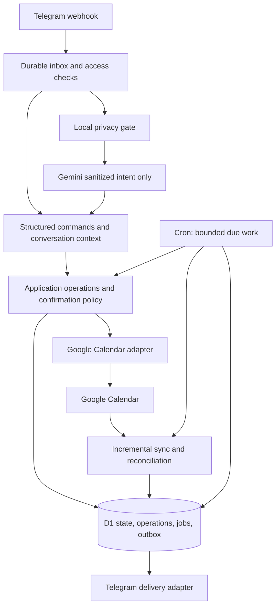

# Oh My Days — backend architecture and delivery plan

Status: Stages 1–8 and 10 implemented, deployed, and released (2.0.0, 2026-10-14);
stage 9 (Gemini interpretation) deferred. §10 has the per-stage record. The
earlier sections are the plan as written and are kept for reference.  
Date: 2026-09-25; status updated 2026-10-14  
Source of truth: [product specification](../specs/oh-my-days.md).

## 1. Outcome and constraints

Build a private Telegram assistant for events and tasks, with Google Calendar as
the calendar interface. Deliver the complete first-version scope in the spec;
intermediate slices are engineering milestones, not scope reductions. Frontend
layout and branding execution will be discussed separately. Minimal authorization
HTTP endpoints are part of this backend plan.

Use free services only and retain deterministic operation without Gemini. Start
with the owner, but enforce independent user boundaries from the first migration.
The central engineering risks are safe retries, Calendar round trips, recurrence,
private-input sanitization, and shared free-tier capacity.

## 2. Architecture

Use one modular TypeScript Cloudflare Worker, one D1 database, and one scheduled
handler. Begin with native HTTP routing, parameterized SQL repositories and SQL
migrations, runtime boundary validation, and a small test runner compatible with
Workers. Proposed tooling: npm with a committed lockfile, Wrangler, TypeScript
strict mode, and Vitest with the Workers integration. Pin current compatible
versions during scaffolding. Add libraries only where they materially reduce risk;
benchmark timezone/recurrence libraries before adopting them.

D1 owns task lifecycle, lists, snoozes, preferences, interactions, operations, and
job state. Google owns provider event state and permissions. Local event records
are a versioned cache, never proof of current write permission. Task projections
are a synchronization boundary: supported external edits become domain commands,
then update application task state. There is no global “last writer wins” rule.

### Module boundaries

| Proposed location | Responsibility |
|---|---|
| `src/worker.ts`, `src/http/` | Fetch/scheduled entry points, routing, authentication, request limits |
| `src/domain/` | Task/event rules, date semantics, recurrence identities, confirmation and reminder policy |
| `src/application/` | Use cases, command validation, authorization, operations, conflict/Undo orchestration |
| `src/telegram/` | Commands, guided flows, callback references, pagination, message rendering |
| `src/calendar/` | Google transport, permissions, mapping, incremental sync and reconciliation |
| `src/interpretation/` | Local safe-template extraction, Gemini adapter, intent schema, fallback |
| `src/storage/`, `migrations/` | User-scoped repositories, constraints, atomic batches, migrations |
| `src/jobs/` | Durable job claiming, leases, retries, reminder/agenda/outbox delivery |
| `src/security/` | OAuth state, encrypted tokens, secret handling, input boundaries |
| `tests/` | Domain behavior, Worker/D1 integration, provider fixtures, acceptance scenarios |
| `docs/adr/`, `docs/runbooks/` | Decisions made during implementation and operating/recovery instructions |

Domain code imports no provider SDKs or Worker bindings. Application code depends
on narrow repository, clock, calendar, delivery, and interpretation interfaces.
Adapters translate errors into typed outcomes: retryable, auth-required, forbidden,
not-found, conflict, validation-failed, and outcome-unknown.

### HTTP and scheduling contract

- `POST /telegram/webhook`: verify the Telegram secret header, allowlisted sender,
  and private-chat identity. Atomically deduplicate and persist accepted updates
  before acknowledging. Return a retryable failure if persistence fails. Process a
  bounded amount immediately; the scheduler recovers unfinished inbox work.
- `GET /oauth/start`, `GET /oauth/callback`: short-lived, single-use linking state
  tied to an already authenticated Telegram user. Validate state and redirect URI,
  exchange authorization code server-side, identify the Google account, and reject
  unconfirmed account replacement. Never accept an arbitrary user ID as authentication.
- `GET /healthz`: minimal liveness only, without user or provider details. Telegram
  `/health` is authenticated and reports that user's connection and sync state.
- Optional `POST /google/notifications`: validate registered channel identity and
  token; only enqueue a coalesced sync hint. Implement after polling correctness.
- One proposed minute cron tick selects indexed due work. This is a scheduling
  target, not a delivery guarantee. Persist progress, bound pages/batches, and give
  reminders and interactive operations priority over maintenance. Do not rely on
  `waitUntil` or memory for durable completion.

## 3. Data model and time

Use opaque application IDs, UTC instants for execution times, IANA timezone IDs,
and explicit local-date values for date-only deadlines. Every owner-scoped key,
foreign-key relationship, query, and uniqueness constraint must preserve tenancy.
Use composite ownership references where supported to prevent cross-user links.

| Record | Important fields and constraints |
|---|---|
| users | Telegram ID unique; private chat ID; timezone; active/allowlisted status; settings version |
| google_connections | User/account identity; encrypted tokens and key version; scopes; reauth status |
| calendars | User + provider calendar ID unique; roles; permission; selected/default flags; task calendar identity |
| task_lists | User + ID; one Inbox per user; unambiguous normalized display names |
| task_series | User/list; recurrence rule/timezone; template; version; expansion cursor |
| task_occurrences | User/list; optional series; immutable occurrence key; title; deadline kind/value; status; version |
| event_cache / calendar_links | User/calendar/event ID; series ID + original start; ETag; relevant field snapshot; task link; tombstone |
| reminder_preferences | User/target occurrence; override and snooze-until; version |
| operations / confirmations | User; idempotency key; target/base version; intended patch; preview hash; recipients/scope; status; expiry |
| jobs / delivery_outbox | User; unique logical key; due-at; lease; attempt count; status; provider message ID; unknown outcome |
| sync_state | User/calendar; cursor/query shape; page progress; generation; last success; failure/outage state |
| inbox / interactions | Update ID unique per bot; owner; processing state; reply mapping; expiring clarification/context |
| contacts / change_history | User-scoped shortcuts; bounded before/after snapshots for valid Undo and recovery |

Index due job scans by `(status, due_at)`, tasks by `(user_id, status, deadline)`,
provider links by user/calendar/provider ID, and pending work by owner/state.
Represent date-only and timed deadlines with mutually exclusive fields and checks.
Exactly one list per task; completed, cancelled, and open are distinct states.
Completed/cancelled history must remain recoverable independently of the live cache.

Task occurrences keep their original identity when moved. Google recurring
instances are identified by calendar, recurring event ID, and original start,
not the mutable current start. Non-recurring events use calendar + event ID.

Proposed recurrence strategy: mirror native Google recurring series for deadline
projections and recurring events; materialize task occurrence state in D1 over a
rolling 90-day future horizon, extending on demand for views and with scheduled
maintenance. Keep all unfinished older occurrences, exceptions, and tombstones.
After a long outage, expand from the saved cursor in bounded pages so missed task
occurrences are not lost. Open-ended recurring tasks use an internal occurrence
schedule without inventing deadlines or calendar entries. Validate this strategy
in the recurrence spike before finalizing schema; bound generation even for long
outages. Follow documented invalid-date semantics instead of silently clamping.

Timezone changes alter future interpretation and agenda scheduling; existing
instants and series retain their stored timezone. Test DST gaps/folds, midnight,
month boundaries, leap years, Monday-start weeks, and exclusive all-day end dates.

## 4. Mutation, confirmation, and recovery protocol

All structured and interpreted requests enter the same typed command pipeline:

1. Resolve the user and target. Prefer an explicit reply reference, otherwise one
   uniquely recent discussed item. Reject multiple instructions without partial work.
2. Validate permissions, deadline/time values, scope, and required details. Clarify
   ambiguity using expiring user-bound interaction state.
3. Read the provider version for a Calendar mutation and construct the intended
   field patch. Persist the base values and operation before external writes.
4. Require confirmation for deletion/cancellation, whole-series changes, and attendee
   notifications. Store exact recipients, scope, patch, expiry, and source versions.
   Callbacks reference server-side state; stale or cross-user callbacks cannot act.
5. Apply local-only changes atomically with their jobs/outbox. For Google changes,
   revalidate current state and use conditional writes where supported. Merge only
   unrelated external changes; ask about same-field conflicts. Changed notification
   previews require renewed confirmation.
6. Persist the verified outcome and derived reminder/projection changes, then send
   a factual result. A local task awaiting its projection is explicitly pending.
   Record a version-bound Undo snapshot for eligible changes.

Operation states: `awaiting_confirmation → ready → applying → succeeded`, with
`retry_wait`, `needs_resolution`, `auth_required`, `failed`, and `cancelled` branches.
Claim work with atomic compare-and-set and expiring leases. Couple local state and
outbox changes in a D1 atomic batch; no transaction spans D1 and Google. Verify
actual D1 transaction semantics before implementation, rather than assuming a
long-running SQLite transaction is available across network calls.

Use stable provider-compatible event IDs for creates where supported. On a
write timeout or crash after the provider write, read/reconcile before repeating.
For edits, compare the current resource with the intended patch and base version.
Never blindly resend attendee notifications. Unknown notification outcomes remain
visible for reconciliation/manual resolution if they cannot be established safely.

Undo is a new validated inverse operation, permitted only when affected fields
have not changed since the original operation. It must respect confirmations and
cannot unsend messages. Retry with bounded exponential backoff and jitter; respect
provider retry hints. Revalidate time, permission, target, and preview on every retry.
Passed scheduled times and conflicting edits require user resolution.

Telegram delivery cannot be assumed exactly once: a send may succeed before a
worker loses the response. Store logical delivery keys and acknowledged message
IDs; distinguish unknown delivery from retryable failure. Avoid automatic blind
replay of unknown sends; record them in health and handle recovery through a
coalesced summary. Document this residual possibility of missed/duplicate delivery.

## 5. Synchronization and projections

Start with incremental polling, with a provisional five-minute interval per active
calendar and coalesced Force poll with a 60-second cooldown. Tune after measuring
usage; show last-sync time and do not promise instant updates. Add push hints only
if channel renewal and reconciliation fit the free budget.

Persist a consistent sync query shape. Apply pages idempotently and advance the
sync token only after the complete page sequence succeeds. An invalid token starts
a staged cache rebuild; retain application tasks and pending work. Reconcile only
a complete successful generation. Incomplete pages, lost access, and errors are
never evidence that all tasks were deleted. Incremental sync and recurring instance
expansion use separate provider requests/cursors as needed by API restrictions.
See [Google incremental synchronization](https://developers.google.com/workspace/calendar/api/guides/sync).

Map task markers using stable stored links and private metadata where available,
not titles. Parse recognized list annotations and the leading completion marker
only as supported external edits. Unknown annotations go through the spec's Inbox
rule without silently creating lists. Discover an existing task calendar through
verified identity or explicit user selection; a matching name alone is insufficient.

Use transparent/free all-day or timed deadline markers. Preserve the true deadline
separately from any display duration and verify it in Google Calendar. Removing a
deadline records an intentional projection deletion before calling Google; its
later deletion echo must not cancel the task. Completion keeps the projection;
external deletion cancels only the linked occurrence. Compare normalized supported
fields and provider versions to suppress update loops and preserve unrelated data.

External recurring edits and exceptions must retain original occurrence identity.
Test series edits against previously completed, cancelled, and moved occurrences;
never regenerate them as new open tasks. See [Google recurring events](https://developers.google.com/workspace/calendar/api/guides/recurringevents).

## 6. Reminders, views, and health

Compute indexed next-due jobs when targets change; do not scan all calendar rows
on every cron tick. Check target version/status again at delivery to suppress stale
reminders. Use one agenda key per user/local date and one reminder key per target,
kind, and schedule version. Handle timezone changes without sending a second agenda
for an already-delivered local date.

At 8am local time, render one combined agenda with events, due/overdue eligible
tasks, and an open-ended count. Date-only reminders are included there. Timed task
and event reminders are separate one-hour-before jobs. Snooze only replaces the
next reminder and suppresses automatic summaries until expiry. Exclude declined
and cancelled events and use no default timed reminder for all-day events.

Catch-up after downtime sends a coalesced summary of eligible overdue tasks and
still-upcoming missed event reminders; skip events already started. Define and
verify handling for future task deadlines with missed alerts and coincident agenda
and reminder jobs. Late-created items inside the reminder window use their creation
confirmation as the approaching notice rather than an immediate duplicate alert.

All specified slash commands, filters, pagination, navigation, task actions, and
settings operate without AI. Weekly/monthly boundaries are calendar periods in the
user timezone. `/health` reports pending/unknown operations and sync status. Alert
once after three completed failed checks, immediately on revoked access, and once
on recovery. Count a check once regardless of its internal retries. A hosting or D1
outage can delay the alerts themselves; an AI outage does not stop these features.

## 7. Security, privacy, and capacity gates

OAuth scope selection must cover selected-calendar reads, authorized event writes,
and task calendar creation with the least sufficient privileges. Record the exact
scopes and ongoing access strategy in the OAuth spike. Encrypt tokens with a
versioned authenticated-encryption key held in Worker secrets; plan rotation and
reconnection. Minimize retained inbox content and protect authorization state from
replay. Verify webhook secret, callback ownership, input sizes, output escaping,
and account-switch behavior.

Gemini is last in the delivery sequence. Start with locally recognized scheduling
templates and opaque content slots; send only an allowlisted action/timing
representation. Arbitrary prose is unsafe by default. If local extraction cannot
prove the outgoing representation contains only permitted information, offer guided
input. Never use an external model as the privacy filter. Validate outbound payloads
with adversarial synthetic fixtures. Recheck [Gemini service terms](https://ai.google.dev/gemini-api/terms),
model free eligibility, and project quota before enabling real requests.

Preserve the spec's operating targets (half of each account allowance; no other
application uses Workers or D1 in the account): 50,000 Worker requests/day,
2.5 million D1 rows read/day, 50,000 rows written/day, and 2.5 GB aggregate storage.
Start with one database and observe its separate size limit. Current documentation
lists 10ms Free Worker CPU and 500 MB per Free D1 database; these are implementation
constraints, not capacity measurements. Sources: [Workers limits](https://developers.cloudflare.com/workers/platform/limits/)
and [D1 limits](https://developers.cloudflare.com/d1/platform/limits/).

For an initial estimate, five-minute polling is 288 checks/calendar/day; the minute
cron is 1,440 invocations/day. Provider calls are not each a new incoming Worker
request, but do consume subrequests and provider quotas. Model pages, retries,
indexed rows, writes, and recurrence expansion separately. Measure actual account
usage including the existing application before deployment. Reduce maintenance
frequency or stop affected work before overrunning budgets; never enable paid overflow.

Proposed retention starting point: expire unused confirmations/OAuth state within
10 minutes, interaction content within 24 hours, processed raw inbox payloads as
soon as processing completes, and operation snapshots after 30 days. Retain minimal
deduplication records through the supported retry horizon. Keep recoverable task
history until an explicit retention policy is validated; do not equate snapshot
expiry with deleting cancelled tasks. Define backup/export and restore procedures,
and test restoration before release. Logs contain IDs, timings, counts, and redacted
error classes, never message bodies or tokens.

## 8. Build order and completion gates

Each numbered stage is one or more feature branches from `develop`, with small
commits for schema, behavior, and verification. Integrate through review. Do not
start dependent stages until their gates pass; document a failed feasibility gate
and revise the proposal rather than hiding it behind later work.

| Stage | Build in this order | Completion evidence |
|---|---|---|
| 0. Feasibility | Inspect shared account capacity when authorized; spike Worker/D1 execution, OAuth access/scopes, exact deadline markers, Google recurrence round trips; assess a safe Gemini input contract | Short decision records with measured constraints, scope choice, marker screenshots/results, and recurrence mapping; no paid dependency required |
| 1. Foundation | Scaffold strict TS Worker, local config, migrations, secret examples/ignores, repositories, clock interfaces, test harness; implement allowlist + durable Telegram inbox and private-chat routing | Local webhook-to-D1 slice works; duplicate updates, rejected users, and cross-user requests tested; migration/check commands documented |
| 2. Safe operations | Build operation state machine, atomic claims/outbox, confirmations, conditional versions, retries, reconciliation hooks, Undo policy with fake adapters | Crash-before/after-side-effect tests; repeated callbacks and stale previews cannot duplicate or bypass policy |
| 3. Google onboarding | OAuth + encrypted tokens, account link, calendars/permissions, default selection, task calendar identity, timezone/settings, minimal /health and auth alerts | Owner can connect via authorized smoke test; read-only calendars rejected for writes; reconnect/account replacement and token failures tested |
| 4. First event slice | Structured /event create, read, edit, delete, overlap check, exact results and Undo; incremental event sync, Force poll, pending recovery/conflict behavior | Round-trip event edits in both interfaces; timeout creates deduplicate; external conflicting edits require resolution; deletion confirmed |
| 5. Task/list slice | Inbox and lists, structured /task, open/date/timed deadlines, projection import/export, completion/reopen/cancel, remove-deadline intent, list moves/deletion | Spec's single-task scenarios pass through both interfaces; task markers are free time; projection deletion cannot accidentally cancel an open-ended task |
| 6. Time and delivery | Scheduler, reminders/overrides, daily agenda, snooze, overdue rules, catch-up, all required deterministic views and pagination | Fake-clock and Worker tests cover 8am dedupe, DST, skipped stale reminders, concurrent cron, completed targets, snooze, and actual calendar periods |
| 7. Recurrence | Native series + occurrence mapping, bounded expansion, exceptions, per-occurrence state, confirmed whole-series edits/deletes, grouped overdue views | Old unfinished occurrences survive; moved/deleted instances retain identity; month-end/leap-year behavior and outage backfill verified |
| 8. Invitations and conversation | Explicit emails/contact shortcuts, recipient previews, organizer restrictions, notification reconciliation, reply-context follow-ups; complete fallback flows and health behavior | No attendee notification without matching confirmation; stale preview re-confirms; no ambiguous follow-up mutation; one outage/recovery alert |
| 9. Optional interpretation path | Local privacy gate, configurable Gemini adapter, schema validation, safe intent-to-command mapping, quota/offline fallback | Outgoing payload inspection shows no private content; multi-action inputs cause no partial work; every deterministic feature works with Gemini disabled |
| 10. Release hardening | Full acceptance matrix, quota/CPU profiling, retention/restore drill, runbooks, authorized private deployment, owner smoke tests | Every spec acceptance row has evidence; limits and delivery caveats documented; no paid overflow; release approved and rollback/reauth paths exercised |

“Optional interpretation path” describes runtime availability, not removing natural
language from v1. Stage 9 must be validated before claiming full specification
coverage. Ordinary input that cannot be safely sanitized uses structured fallback.

## 9. Verification and handoff

At scaffold time define `lint`, `typecheck`, `test`, integration-test, and local
migration commands in the README. Until then, these are planned commands, not
existing tooling. Prefer domain tests for policy, local Worker/D1 tests for leases,
constraints and recovery, fake HTTP provider tests for sync/version failures, and
a small authorized real-account suite for contracts fakes cannot prove.

Create an acceptance matrix mapping every row of spec section 12 to tests and each
validation item in section 13 to measured evidence. Include concurrent requests,
unknown send outcomes, invalid sync tokens, lost permissions, user separation,
malicious callback data, unsafe AI input, and cost/CPU limits. Passing unit tests
alone is insufficient to release OAuth, Calendar projections, or invitations.

Do not provision services or send real invitations as a side effect of
implementation work. Frontend decisions remain outside this delivery plan.

## 10. Implementation status

| Stage | Status | Evidence |
|---|---|---|
| 0. Feasibility | Partial: local D1 semantics only | [Stage 0 status](../feasibility/stage-0.md); account-dependent checks pending |
| 1. Foundation | Implemented, tested locally | Webhook secret, allowlist, private-chat filter, durable deduplicated inbox, per-user serialized processing, outbox with unknown-outcome handling, scheduled recovery and retention (`tests/http`, `tests/jobs`) |
| 2. Safe operations | Implemented, tested locally with fake Calendar | Operation state machine, leases and guarded batches ([ADR 0001](../adr/0001-leases-and-guarded-d1-batches.md)), confirmations bound to preview hash, reconfirmation on changed targets, bounded retries with one pending notice, reconciliation after lost responses and crashes, field-level conflict detection, version-checked Undo (`tests/application`, `tests/domain`) |
| 3. Google onboarding | Implemented, tested locally with fake Google; not deployed or tried with a real account | OAuth with PKCE and single-use state, encrypted tokens (AES-GCM bound to user and purpose), scope and identity checks, account-replacement confirmation, interrupted-callback handling, token refresh with one auth alert per outage, calendar list and selection, default and task calendar (create or explicit link), timezone, `/settings`, `/health`, connection pages, homepage and privacy policy (`tests/flows`, `tests/google`, `tests/security`) |
| 4. First event slice | Implemented, tested locally with fake Google; not yet deployed | Guided `/event` create (title, day, time, length or end time, all-day), rename, move keeping length, confirmed delete; exact results with Undo; overlap check read live from selected calendars (free, declined, and task markers excluded); incremental sync with sync tokens, paging, full rebuild on expired tokens, no deletion from failures or lost access; hourly calendar-list refresh; Force poll with cooldown; `/health` sync status (`tests/flows/events.test.ts`, `tests/jobs/calendar-sync.test.ts`, `tests/domain`) |
| 5. Task/list slice | Implemented, tested locally with fake Google; not yet deployed | Inbox and lists (create, move, delete to Inbox); `/task` guided creation with no, date-only, or exact deadlines; `/tasks` view with list filters; complete, reopen, rename, change or remove deadline, confirmed cancel with Restore; version-bound Undo; deadline markers (`[List] Title`, `✓` when done, free, Google notifications off) projected by operation; Calendar edits to title, list annotation, ✓, deadline, and deletion imported on sync; entries created in the task calendar become tasks; removing a deadline never cancels; same-field conflicts reported (`tests/flows/tasks.test.ts`, `tests/domain/tasks.test.ts`) |
| 6. Time and delivery | Implemented, tested locally with fake Google and clocks; not yet deployed | 8am agenda per local date (catch-up later that day, no duplicate across timezone changes or overlapping runs); event reminders 1 hour before (declined skipped, started skipped, moved revalidated); exact-deadline reminders with Done/Snooze; snooze (1 hour, tomorrow 8am, typed) that never moves the deadline and folds into the agenda; per-event and per-task reminder overrides; one catch-up summary after downtime; creation inside the window counts as the notice; `/daily`, `/weekly`, `/monthly`, `/calendars`, `/overdue`, `/reminders` read Google live with a labelled fallback (`tests/flows/reminders.test.ts`, `tests/domain/schedule.test.ts`) |
| 7. Recurrence | Implemented, tested locally with fake Google; not yet deployed | Recurring tasks as series with independent, materialized occurrences on a 60-day horizon (ADR 0003): month-end and leap-day rules stated and followed, bounded outage backfill, per-occurrence completion/cancellation/markers, confirmed series rename and stop, grouped overdue lines; recurring events created natively with a stated schedule; one occurrence vs. whole-series rename, time change, and delete (series confirmed); event pickers list recurring occurrences (`tests/flows/recurrence.test.ts`, `tests/domain/recurrence.test.ts`) |
| 8. Invitations and conversation | Implemented, tested locally with fake Google; not yet deployed | Invitations by email or saved contact (unknown names asked, never guessed; save offered); every guest-notifying change (invite, edit, delete, Undo) previewed with exact recipients and confirmed, re-confirmed if guests changed, never re-sent after an unknown outcome; organizer-only restriction; reply and last-item follow-ups ("move it to 4pm", "rename it to…", "delete it", "done") from a fixed grammar; same-field conflict choice for events and tasks; one outage alert after 3 failed checks and one recovery notice; contacts in /settings (`tests/flows/conversation.test.ts`, `tests/domain/follow-up.test.ts`) |
| 9. Interpretation path | **Deferred by the owner on 2026-10-04** | Still in scope: natural-language input through Gemini with the local privacy gate. Until then, every feature works through structured commands and buttons, and no data is sent to Gemini. Acceptance rows that need it are marked Deferred in the [acceptance matrix](../acceptance.md). |
| 10. Release hardening | Done for the structured release (2026-10-04) | [Acceptance matrix](../acceptance.md); [capacity measurements](../capacity.md) (CPU tuned from 10–22 ms to a median of 8 ms per run); restore and rollback drills and [operations runbook](../runbooks/operations.md); data-deletion SQL tested. Owner release approval pending. |

Post-release improvements ([improvement plan](improvements.md)) are tracked in
that plan's status column. All of them were deployed on 2026-10-10 and released
in 2.0.0 on 2026-10-14. The stage table above keeps the wording recorded when
each stage was built ("not yet deployed" there is historical). Implemented:

- A2: one shared date grammar (`src/domain/parse-input.ts`) for guided input,
  follow-ups, and snoozing: weekdays, `next`/`this <weekday>`, `in N days/weeks`,
  `next week`, `end of month`, time ranges (`7-9pm`), and number-word
  durations. Ambiguous input asks with dated buttons ("Which Friday?", "3am or
  3pm?"); follow-ups accept `make that`/`make it` (`tests/domain/parse-input.test.ts`,
  `tests/flows/typed-dates.test.ts`).
- A1: quick capture (`src/domain/capture.ts`, `src/application/capture-flow.ts`).
  Plain text that is not an answer or a follow-up becomes one event or task
  through the existing create operations, or a question (dates, am/pm, task or
  all-day event); several requests in one message are refused; unreadable text
  gets **Add as task · Add as event · Cancel**. Results carry Undo and a type
  switch: **Make it a task** confirms removal of the event (bound to its created
  version) and the task is created only after the deletion is verified; **Make
  it an event** confirms, cancels the unchanged task, then creates the event.
  Choice buttons act once (`tests/domain/capture.test.ts`,
  `tests/flows/capture.test.ts`). "That isn't available yet" now only answers
  unknown commands.
- A3: `/help` leads with typed examples (each checked against the grammar in
  `tests/flows/help.test.ts`); the first three guided creations add "Next time
  you can type: …", counted in `users.typing_hints_shown` (migration 0011).
- A4: every question waiting for typed input is built by one helper
  (`src/application/cancel.ts`) that adds **Cancel**; button-only questions
  (repeat, list, "Which Friday?") have Cancel too. `/cancel` drops the open
  question and says what was abandoned. An older Cancel never closes a newer
  question (`tests/flows/cancel.test.ts`).
- B3: each tick records its finish time in `app_state`; `/healthz` returns
  `ok tick_age_s=N`, or 503 `stale …` when none finished in 10 minutes or none
  has run. `/health` shows the same age (`tests/http/liveness.test.ts`).
- B1: with `TESTING_TOKEN_TTL_DAYS` set, frequent maintenance sends one
  "Google access ends tomorrow around …" warning with **Reconnect** a day before
  `connected_at + TTL`, recorded per `auth_generation` (migration 0012);
  `/health` shows "Reconnect by …". The after-the-fact alert is unchanged
  (`tests/flows/access-expiry.test.ts`).
- B5: an agenda still unsent at 12:00 local is "Catch-up: today so far." with
  only events that haven't ended; from 20:00 it is skipped and the date recorded
  as covered; finishing setup after 08:00 covers that day (spec §8,
  `tests/flows/late-agenda.test.ts`). This replaces stage 6's "catch-up later
  that day".
- B4: the reminder pass visits only users whose `next_due_at` has passed
  (at most an hour apart); triggers clear it on task, override, horizon, and
  timezone changes, and `due_version` keeps a concurrent change from being
  overwritten ([ADR 0004](../adr/0004-next-due-time-by-trigger.md), migration
  0013, `tests/jobs/idle-ticks.test.ts`). Local count: reminder-pass reads per
  idle hour 576 → 6 ([capacity](../capacity.md)); live re-measure pending.
- C1: the agenda and `/daily` add **Act on a task** (today's overdue and due
  occurrences; picking one opens Done · Snooze · Edit) and **Snooze all overdue
  → tomorrow 8am**: one confirmation with the count, bound to each task's
  version; deadlines never move; one Undo restores each earlier snooze unless
  the task changed since (`tests/flows/act-on-agenda.test.ts`).
- C2: Google's `location`, video link (`hangoutLink` or a conference video
  entry point), and `htmlLink` are read into a display-only `EventDisplay`
  outside `EventFields` (https links only, Calendar links only from Google
  hosts). They live with the event horizon (migration 0014, removed when the
  occurrence leaves the ~26-hour window) and are refreshed from the live read
  before a reminder. Single event reminders show "Where:", "Video call:", and
  **Join call** / **Open in Calendar** URL buttons. The privacy policy now says
  so (`tests/google/event-display.test.ts`, `tests/flows/reminders.test.ts`).
- C3: `/find <words>` lists open tasks and synced one-off events whose title
  contains the words (SQLite `LIKE`, so case-insensitive for ASCII only; `%`
  and `_` literal), upcoming events before past ones, plus one line per
  recurring series from a live Google `q` search over the next year; at most 20
  results, 8 per page; a note says when Google couldn't be searched. "Change an
  event" gains **Pick a date** for any day (`tests/flows/find.test.ts`).
- C4: when the user has another writable calendar, a new one-off event's
  result shows **Calendar: X ▸**; choosing one runs a `calendar.event.move`
  operation (Google `move`, no guest emails) that first re-reads the event and
  refuses if it changed since creation; a lost response is reconciled by
  finding the event in the destination; Undo moves it back. Quick capture also
  accepts `on <calendar>` (`tests/flows/calendar-choice.test.ts`).
- C5: `/tasks` has **Recent**: tasks completed or cancelled in the last 30 days
  (newest first, up to 100, 8 per page); each opens its card with the existing
  version-bound Reopen/Restore, which re-creates a deadline marker
  (`tests/flows/recent.test.ts`).
- C6: deleting a one-off event that had no guests (as read just before the
  delete) offers **Restore** for 24 hours. It creates a new event (new ID) with
  the deleted title and time in the same calendar, through the normal create
  operation, once, and says it is a copy without the description, location, or
  attachments. Events with guests, series, and occurrences are excluded
  (`tests/flows/restore-event.test.ts`).
- C7: changing timezone offers buttons for the user's recent zones (newest
  first, up to three, migration 0015) and a short common list; a typed city
  matches the runtime's IANA zones by city name (`London` → `Europe/London`),
  and a shared name or a partial name offers choices. Region/City still works
  (`tests/domain/timezones.test.ts`, `tests/flows/timezone-choice.test.ts`).
- D1: `/settings` sets the agenda hour (6–11am, default 8) and the default
  reminder lead for timed events and exact deadlines (10 min–2 h, default 1 h;
  per-item overrides win). Migration 0016 adds both, with a trigger that clears
  `next_due_at`. The agenda stays keyed by local date. "Tomorrow at …" snoozes
  follow the agenda hour. The setup summary no longer says event and task
  creation "arrives in a later update" (`tests/flows/schedule-settings.test.ts`).
- D2: an optional evening "Tomorrow" message (off by default; 6–10pm in
  `/settings`, migration 0017) renders the next day like the agenda, once per
  date (recorded in `agenda_runs` as `evening:<date>`), never after midnight.
  The reminder pass schedules it in `next_due_at`
  (`tests/flows/evening-preview.test.ts`).
- D5: optional quiet hours (presets 10/11pm–7/8am, migration 0018). While a
  window is active the reminder pass holds everything (no reads) and schedules
  itself for the window's end; then reminders still relevant are sent as one
  "While quiet hours were on:" summary. Agenda and evening preview are not
  held (`tests/flows/quiet-hours.test.ts`).
- D3: repeat questions for tasks and events offer Weekdays, Last day of month,
  and **Every…** (typed "every 2 weeks"); series store the interval and a
  `by_rule` (migration 0019) and materialize as before (ADR 0003). Events use
  `BYDAY=MO,TU,WE,TH,FR` and `BYMONTHDAY=-1` (the plan named `BYSETPOS=-1`;
  `BYMONTHDAY=-1` is the direct RFC 5545 form). A date outside the rule starts
  the series at the first matching date (`tests/domain/recurrence.test.ts`,
  `tests/flows/repeat-rules.test.ts`).
- D4: **Schedule time** on an open task asks day, time, and length (no all-day,
  no repeat) and creates an ordinary one-off event in the default calendar
  through the create operation; on success it is linked in `task_sessions`
  (migration 0020). The task card lists upcoming work time, preferring the
  synced copy (so Google moves and deletions show). The deadline never changes,
  and completing the task leaves the event (`tests/flows/work-sessions.test.ts`).
- D6: `/export` sends one JSON document (tasks with history, lists, recurring
  tasks, contacts; no tokens, account, or event copy), at most 1 MB, through the
  outbox as `sendDocument` (multipart upload; never replayed after an unknown
  outcome; the payload is cleared once sent). Migration 0021 rebuilds
  `telegram_outbox` to allow the method, keeping rows and indexes
  (`tests/flows/export.test.ts`, `tests/telegram/client.test.ts`,
  `tests/storage/d1-semantics.test.ts`).
- D7 (Mini App), step 5a: [ADR 0005](../adr/0005-mini-app-surface-and-initdata-auth.md).
  `/app` serves the page and `/app/app.js` (esbuild bundle of
  `src/miniapp/client`, regenerated by `npm run check`); `/app/api/*`
  verifies `initData` (HMAC, ≤1 hour, allowlist, active user, setup done) and
  serves Home, Today, Week, task sets, task detail, and Recent from the chat's
  queries. Open app appears under the agenda, `/daily`, and `/tasks`, as
  `/app`, and as a persistent keyboard button answered with an inline launch
  (keyboard launches carry no `initData`) (`tests/miniapp/`).
- D7 steps 5b–5c: `POST /app/api/…` task writes (complete, reopen, snooze,
  rename, move, deadline, confirmed cancel, quick add, series rename/stop) and
  bulk complete/snooze/move/cancel reuse the chat's task change statements,
  check the task version (409 with the current task), and record a client key
  in the same batch (migration 0022) so replays change nothing. The client adds
  check-off with Undo, swipe, task actions, multi-select with Telegram's main
  button, and quick add. Smoke-tested in headless Chrome against `wrangler dev`.

Stage 2 decisions to review:

- Undo of a just-created event is a deletion, so it shows the standard delete
  confirmation (decided 2026-10-02). It is bound to the created version; any
  later edit makes Undo unavailable. Undo of a deletion is not offered; for
  events without guests, improvement C6 offers Restore (a new copy) instead.
- Users outside the allowlist who message the bot privately receive "This bot
  is private." as the webhook response; nothing about them is stored, and
  group chats get no reply (decided 2026-10-02).
- Callback effects (confirm/cancel/undo) commit in their own batch, keyed by the
  Telegram callback query ID, rather than inside the inbox lease; a redelivered
  press reports the original result.
- Calendar event handlers (create/patch/delete) now run against the Google
  adapter, but no command creates events yet (stage 4).

Stage 3 decisions and gaps to review:

- Served at a custom domain with a homepage and privacy policy for
  OAuth verification ([ADR 0002](../adr/0002-custom-domain-and-oauth-verification.md)).
- The OAuth app stays in Testing until verified, so access expires every 7 days
  and the bot asks for reauthorization.
- Setup ends with a summary instead of the brief's **Add event · Add task · View
  today** buttons, because those features do not exist yet (stages 4–6).
- `/health` has no **Force poll** button and no sync time until stage 4 adds sync.
- A "Calendar access wasn't granted" page state was added for users who untick
  Calendar permissions on Google's consent screen.
- Finished operations are purged after 30 days, as the privacy policy states.

Stage 4 decisions and gaps to review:

- Guided input accepts a small fixed set of date, time, and duration forms
  (day-first numeric dates); anything else is refused and asked again.
- New events use the default calendar; quick capture (improvement A1) accepts
  `on <calendar>` for another writable calendar.
- Events with guests, recurring events, and view-only calendars are shown but
  not changeable from Telegram (stages 7–8).
- The event cache stores recurring series masters but lists and overlap checks
  use one-off events and live windowed reads; recurring instances in views
  arrive with stage 7. All-day events are not treated as time conflicts.
- Sync health alerts (three failed checks, recovery) are deferred to stage 8;
  `/health` already reports failed checks.
- Same-field conflicts stop with a message; choosing which value to keep from
  Telegram is still to come.

Stage 5 decisions and gaps to review:

- Exact-time deadline markers are zero-length entries at the due time; the
  owner checked date-only and exact-time markers in Google Calendar on
  2026-10-03 (validation item 3).
- Each marker creation uses a fresh ID (the operation ID), because Google keeps
  deleted event IDs; a restored task gets a new marker.
- An unknown `[annotation]` on an entry created in the task calendar stays in the
  title and the task goes to Inbox; no list is created automatically.
- Undo of creating a task asks to confirm the removal (a cancellation), matching
  the event Undo decision; other task Undos restore prior values directly.
- Snooze, reminders, agendas, and overdue views are stage 6; recurring tasks are
  stage 7.

Stage 6 decisions and gaps to review:

- Views and the agenda read Google live (recurring occurrences included) and
  fall back to the synced copy with a visible note. Reminders use a rebuilt
  26-hour horizon of occurrences and re-read each event before sending.
- When several reminders fall due together, or one is more than 10 minutes
  late, they are sent as a single summary.
- A snooze ending at agenda time is folded into the agenda instead of a second
  message.
- Overdue occurrences of recurring tasks are grouped in stage 7; sync health
  alerts remain stage 8.

Stage 7 decisions and gaps to review:

- Recurring task markers are individual entries per occurrence up to 60 days
  ahead, not a native series ([ADR 0003](../adr/0003-recurring-task-occurrences.md)).
- Recurring tasks repeat with an interval of 1 from the structured flow; other
  intervals and changing a series' schedule (stop it and create a new one) are
  not offered yet.
- A recurring task's due time skipped by a DST change uses the next valid
  hour (RFC 5545); the occurrence keeps its date.
- Moving a whole event series changes its time of day only; all-day series and
  "this and following" scope are edited in Google Calendar for now.
- Recurring events created directly in the task calendar are not imported as
  recurring tasks.

Stage 8 decisions and gaps to review:

- Follow-ups are recognized from a small fixed grammar without AI (`make that
  Friday` added by improvement A2); free-form follow-ups beyond it arrive with
  interpretation in stage 9.
- When guests are invited, Google also emails existing guests an update; the
  preview says so.
- The most recently discussed item stays the default target for 24 hours.
- Guests can't be removed from Telegram yet.

Landing page (owner request, 2026-10-15; [ADR 0006](../adr/0006-landing-page-as-static-assets.md)):
implemented on `feature/landing-page`, built and checked locally, not yet
deployed. `landing/src` is prerendered by `scripts/build-landing.mjs` into
`landing/dist`, which the Worker serves as static assets at `/`; the Worker's
own `/` route was removed (`tests/flows/google-setup.test.ts`). The move to the
new host is a deploy-time step in the [deploy runbook](../runbooks/deploy.md#move-to-a-new-host).

Mini App polish (owner, 2026-10-16; [ADR 0007](../adr/0007-mini-app-display-type-and-depth.md)):
released as 2.2.0 (#27, #28, #30) and deployed to production from `main` on
2026-10-16 as Worker version `ebaeda34`. The
design rules in `DESIGN.md` and the identity doc were relaxed for display type,
soft depth, and tide lines on the Mini App's launch and All clear screens. Figtree is served from
`/app/figtree-<hash>.woff2`; Home's read model gained progress, overdue age,
week days, list overdue counts and an `allClear` flag, and task screens gained
the user's local time and series labels (`tests/miniapp/read-api.test.ts`).
The client screens were checked visually in headless Chromium with a stubbed
Telegram object and synthetic data, not yet inside Telegram. The README and
landing page screenshots were retaken from the same harness; the 2.1.0 ones are
in `docs/screenshots/archive/`.

Bulk import (owner, 2026-10-16): `/import`, released as 2.3.0 (#32, #33) and
deployed to production from `main` on 2026-10-17 as Worker version `475df748`;
the command menu re-registered with `/import` on the next maintenance tick. `src/domain/import.ts` reads each line with the
quick-capture grammar; `src/application/import-flow.ts` previews, confirms,
and undoes (`tests/flows/import.test.ts`, `tests/domain/import.test.ts`). The
cap of eight tasks comes from Workers Free's 50 D1 queries per invocation:
measured worst case (every deadline inside the reminder window) is within 50
for eight. The webhook's after-accept work now handles one update and skips
calendar work when that update used more than 24 queries (`AFTER_ACCEPT_LIMITS`
in `src/app.ts`, metered by `src/storage/query-meter.ts`); replies are still
delivered at once and the minute tick does the rest.

A gap found while measuring, fixed on the same branch: the Mini App's bulk
actions accepted up to 100 tasks and read each one separately, about 3 queries
per task, so completing 16 or more at once exceeded the 50-query limit. The
selected tasks are now read in one query, one change request holds at most 20
(`src/miniapp/limits.ts`; measured within 50 for every bulk action), and the app
sends a selection of up to 100 in parts of 20 with one combined summary
(`src/miniapp/client/bulk.ts`). A cancel preview still covers the whole
selection and returns one confirmation per part, each bound to exactly its tasks
and versions (`tests/miniapp/write-api.test.ts`, `tests/miniapp/bulk-parts.test.ts`).

Several reminders per item (owner, 2026-10-20): on `feature/item-reminders`,
tested locally, not deployed ([ADR 0008](../adr/0008-several-reminders-per-item.md),
migration 0023). An event or task has up to five reminders: a lead time, a time
on its day or up to 7 days before, or a fixed time. Date-only deadlines can
have them too (`src/domain/reminders.ts`, one parser for chat and the Mini
App). `src/application/reminder-plan.ts` plans every reminder for the reminder
pass, `/reminders`, and the Mini App. Events beyond the 26-hour horizon (and
all-day events) are scheduled from the start kept with their reminders, then
re-read from Google before sending; a moved event's kept start is updated. The
chat has a toggle menu with Custom…, Default, and None, plus "remind me …"
follow-ups (`src/application/reminder-flow.ts`). The Mini App has
`GET event-reminders` and `POST reminders`, version-checked and idempotent
(`src/miniapp/reminders.ts`), a sheet on task detail, and a sheet when an event
is tapped. A user's pass handles at most 8 due reminders, so a pass with twenty
due (and that day's agenda) stays within 50 queries
(`tests/flows/item-reminders.test.ts` "query budget"). Tests:
`tests/domain/reminders.test.ts`, `tests/flows/item-reminders.test.ts`,
`tests/miniapp/reminders-api.test.ts`, and a purge case in
`tests/jobs/tick.test.ts`. The Mini App sheets were checked in headless
Chromium with a stubbed Telegram object and API responses taken from the test
world (synthetic data): task detail, the reminders sheet, adding a typed
reminder, and the event sheet. They have not been tried inside Telegram.
